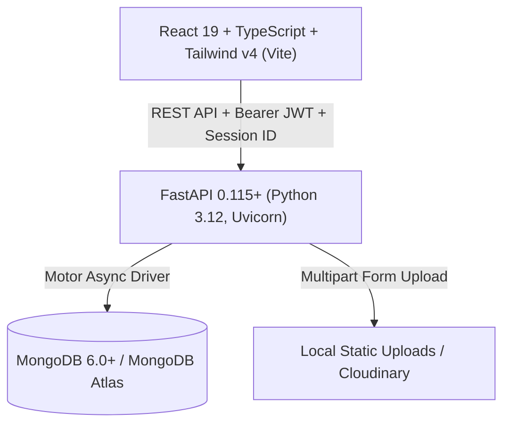

# Shiridi Sai Enterprises — Premium E-Commerce Website & Admin Dashboard

[](https://fastapi.tiangolo.com)
[](https://react.dev)
[](https://www.typescriptlang.org)
[](https://tailwindcss.com)
[](https://www.mongodb.com)
[](https://pytest.org)
[](LICENSE)

A complete, modern, production-grade e-commerce application designed for **Shiridi Sai Enterprises**, a furniture and home-furnishing business specializing in solid Burma teak, Sheesham, and contemporary home decor.

The platform provides two seamlessly connected interfaces:
1. **Customer Public Storefront**: A responsive furniture shopping experience featuring real-time debounced search, promotional offer carousels, category filtering, multi-image product inspection with zoom, color variants, live cart calculation, and Cash on Delivery (COD) checkout.
2. **Admin Management Dashboard**: A role-based administration portal giving store owners full control over product catalogs, categories, banners, order fulfillment timelines, user accounts, store policies, and audit logs without writing code.

---

## 🌟 Key Features

### 🛍️ Customer Shopping Storefront
- **Mobile-First Responsive Design**: Optimized for mobile screens, tablets, laptops, and ultra-wide desktop monitors.
- **Header & Real-Time Search**: Live debounced search querying product titles, descriptions, categories, brands, and color finishes with instant dropdown suggestions.
- **Promotional Offer Carousel**: Auto-rotating hero banners with custom CTA links, scheduling, and responsive slide controls.
- **Curated Shop by Category**: Dynamic grid of furniture collections (Sofas, Dining, Beds, Mattresses, Wardrobes, Office Furniture, etc.) with product count badges.
- **Product Details & Zoom**: Multi-image thumbnail gallery, hover magnifying lens zoom, dynamic color and dimension variant selector, stock level indicators, warranty badges, and related recommendations.
- **Persistent Cart & Revalidation**: Cart items persist across reloads and sync automatically with authenticated accounts. Backend re-verifies inventory and prices on every operation.
- **Cash on Delivery (COD) Checkout**: Zero-friction checkout collecting delivery addresses, landmarks, and PIN codes. Backend server calculates all taxes and delivery fees securely.
- **Track Order & Confirmation**: Real-time status lookup (Placed, Confirmed, In Production, Out for Delivery, Delivered, Cancelled) with cancel eligibility and receipt printing.
- **Customer Account Portal**: Sign in/up, profile editing, saved address book, and complete order history.

### 🛡️ Admin Management Dashboard (`/admin`)
- **Role-Based Access Control (RBAC)**: Secure JWT cookies/headers restricting admin routes to `admin`, `super_admin`, `product_manager`, and `order_manager`.
- **Live Business KPIs**: Real-time dashboard tracking total sales, pending orders, out-of-stock warnings, customer counts, and collection revenue.
- **Product Management**: Full CRUD with multi-image file uploader, color variants, SKU tracking, dimensions, discount percentages, and low-stock alerts.
- **Category & Subcategory Manager**: Create, reorder, publish/hide, and safely delete categories with image uploads.
- **Promotional Banner Manager**: Add, reorder, toggle, and schedule hero promotional banners.
- **Order Dispatch & Status Workflow**: Update fulfillment status with tracking numbers, courier partner names, and delivery notes.
- **Storefront Customizer**: Modify store name, logo, phone, WhatsApp chat hotline, physical address, free delivery thresholds, and policy text without touching code.
- **Security Audit Trail**: Immutable logging recording every admin action, resource affected, timestamp, and IP address.

---

## 🏗️ Architecture & Technology Stack



- **Frontend**: React 19, TypeScript 5.9, Vite 6, Tailwind CSS v4 (`@tailwindcss/vite`), Lucide React, React Router v7.
- **Backend**: Python 3.12, FastAPI, Motor (Async MongoDB), Pydantic v2, PyJWT, Bcrypt, Uvicorn.
- **Database**: MongoDB Atlas or Local MongoDB with unique email indexes, product slug indexes, order number indexes, and text indexes.
- **Image Storage**: Pluggable architecture supporting local multipart uploads (`/static/uploads`) or Cloudinary.
- **Deployment**: Render-ready blueprint (`render.yaml`) with separated frontend static site and backend API service.

---

## 📁 Repository Structure

```
shiridi-sai-enterprises/
├── backend/
│   ├── app/
│   │   ├── api/
│   │   │   ├── deps.py              # JWT authentication & RBAC dependencies
│   │   │   └── routes/              # Storefront & Admin API routers
│   │   ├── core/
│   │   │   ├── config.py            # Pydantic environment settings
│   │   │   └── security.py          # Password hashing & JWT token generators
│   │   ├── db/
│   │   │   ├── mongodb.py           # Motor async client & index initialization
│   │   │   └── seed.py              # Automatic database seeder
│   │   ├── schemas/                 # Pydantic request/response schemas
│   │   ├── tests/
│   │   │   └── test_api.py          # Automated Pytest suite
│   │   └── main.py                  # FastAPI application entrypoint & lifespan
│   ├── static/uploads/              # Uploaded media assets
│   ├── requirements.txt             # Python dependencies
│   └── .env.example                 # Backend environment template
├── frontend/
│   ├── src/
│   │   ├── api/client.ts            # Typed HTTP client with session header
│   │   ├── components/              # Shared common, store & admin components
│   │   ├── context/                 # Auth, Cart, Store & Toast React contexts
│   │   ├── layouts/                 # StoreLayout & AdminLayout
│   │   ├── pages/                   # Storefront, account & admin page views
│   │   ├── routes/AppRoutes.tsx     # Route mapping table
│   │   ├── types/index.ts           # Shared TypeScript interfaces
│   │   └── App.tsx                  # Root app provider setup
│   ├── vite.config.ts               # Tailwind v4 plugin & API proxy config
│   ├── tsconfig.app.json            # TypeScript compiler configuration
│   ├── package.json                 # Frontend dependencies & scripts
│   └── .env.example                 # Frontend environment template
├── .gitignore                       # Git ignore rules for Python, Node & Media
├── render.yaml                      # Render Blueprint Infrastructure-as-Code
└── README.md                        # Documentation
```

---

## 🚀 Getting Started Locally

### 1. Prerequisites
- **Node.js**: v18.0 or newer
- **Python**: v3.10, v3.11, or v3.12
- **MongoDB**: A running local MongoDB instance (`mongodb://localhost:27017`) or a free [MongoDB Atlas](https://www.mongodb.com/cloud/atlas) cluster connection string.

---

### 2. Backend Setup

```bash
# Navigate to the backend directory
cd backend

# Create and activate a Python virtual environment
# On Windows PowerShell:
python -m venv venv
.\venv\Scripts\Activate.ps1

# On Linux/macOS:
python3 -m venv venv
source venv/bin/activate

# Install dependencies
pip install -r requirements.txt

# Create your .env file
cp .env.example .env

# Run the FastAPI server (auto-seeds database on first run)
uvicorn app.main:app --reload --port 8000
```

The backend API will be available at:
- **API Base**: `http://127.0.0.1:8000/api/v1`
- **Interactive Swagger Docs**: `http://127.0.0.1:8000/docs`
- **Alternative ReDoc**: `http://127.0.0.1:8000/redoc`

---

### 3. Frontend Setup

In a new terminal window:

```bash
# Navigate to the frontend directory
cd frontend

# Install npm dependencies
npm install

# Start the Vite development server
npm run dev
```

Open your browser at `http://localhost:5173`. Vite automatically proxies `/api` and `/static` requests to `http://127.0.0.1:8000`.

---

## 🔑 Default Credentials

When started for the first time, the database is seeded automatically with categories, promotional banners, furniture catalog items, site settings, and default user accounts:

| Role | Email | Password | Access Area |
| :--- | :--- | :--- | :--- |
| **Administrator** | `admin@shiridisaienterprises.com` | `Admin@123456` | `/admin` & `/admin/login` |
| **Customer** | `customer@example.com` | `Customer@123` | Public Storefront & `/account/login` |

> *Tip: You can change the admin password or create additional staff accounts directly from the Admin Dashboard at `/admin/customers`.*

---

## 🧪 Automated Testing

### Backend API Test Suite
Run the automated Pytest suite to verify healthchecks, authentication, RBAC, category querying, product search, cart operations, and order placement:

```bash
cd backend
.\venv\Scripts\pytest -v app/tests/test_api.py
```

### Frontend Typecheck & Build Test
Verify that all TypeScript code and Tailwind styles build cleanly for production:

```bash
cd frontend
npm run build
```

---

## ☁️ Deployment Guide (Render & MongoDB Atlas)

This repository includes a `render.yaml` blueprint for one-click deployment on Render:

1. **Set Up MongoDB Atlas**:
   - Create a free cluster on [MongoDB Atlas](https://www.mongodb.com/cloud/atlas).
   - Under **Database Access**, create a user and password.
   - Under **Network Access**, add `0.0.0.0/0` (allow access from anywhere).
   - Copy the connection URI: `mongodb+srv://<username>:<password>@<cluster>.mongodb.net/?retryWrites=true&w=majority`.

2. **Deploy on Render**:
   - Push this repository to your GitHub account.
   - In Render, click **New +** -> **Blueprint**.
   - Connect your GitHub repository.
   - Fill in the required environment variable `MONGODB_URI` with your MongoDB Atlas connection string.
   - Render will build and deploy both the **FastAPI Web Service** and the **Vite Static Site**.

---

## 📄 License
This project is open-source and available under the [MIT License](LICENSE).
